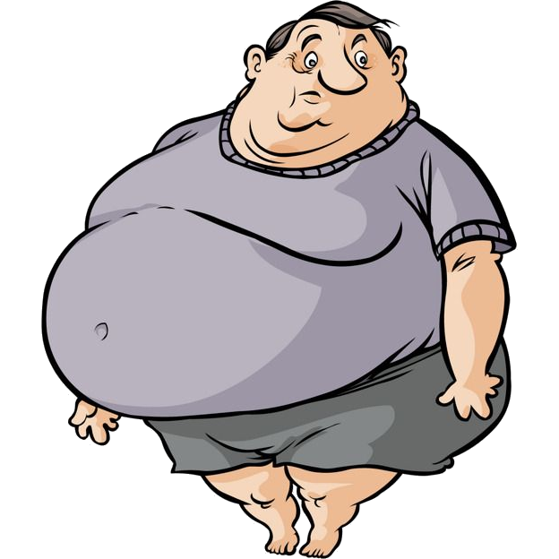
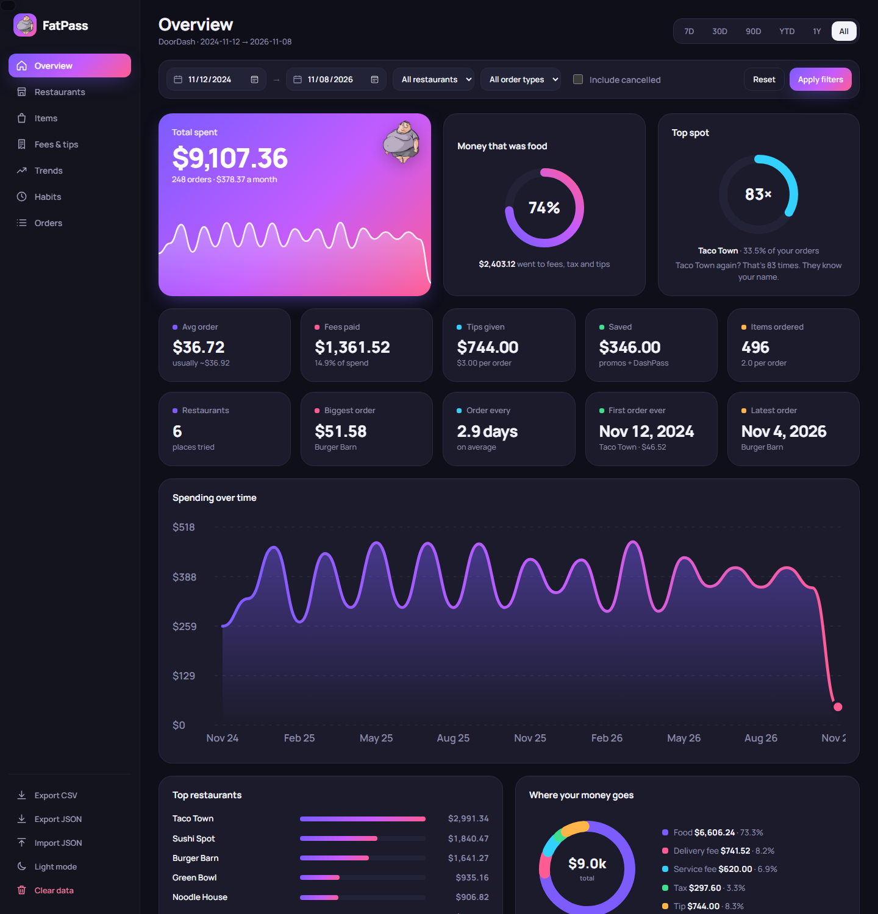
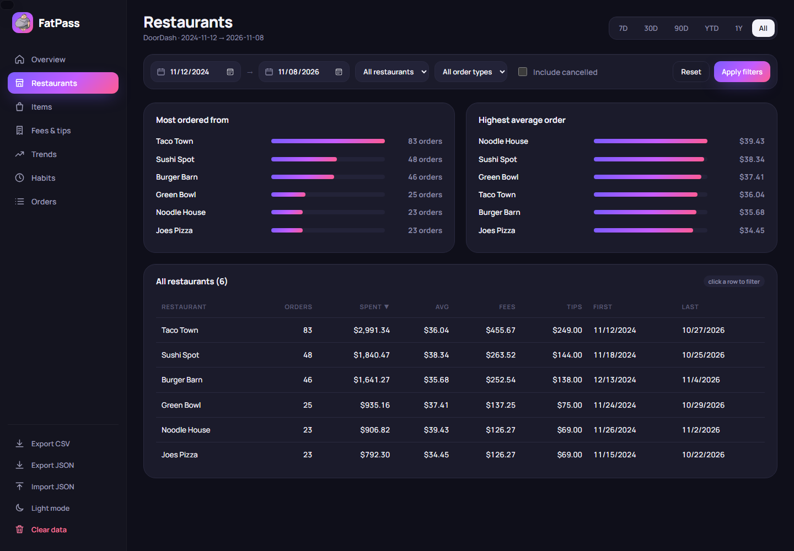
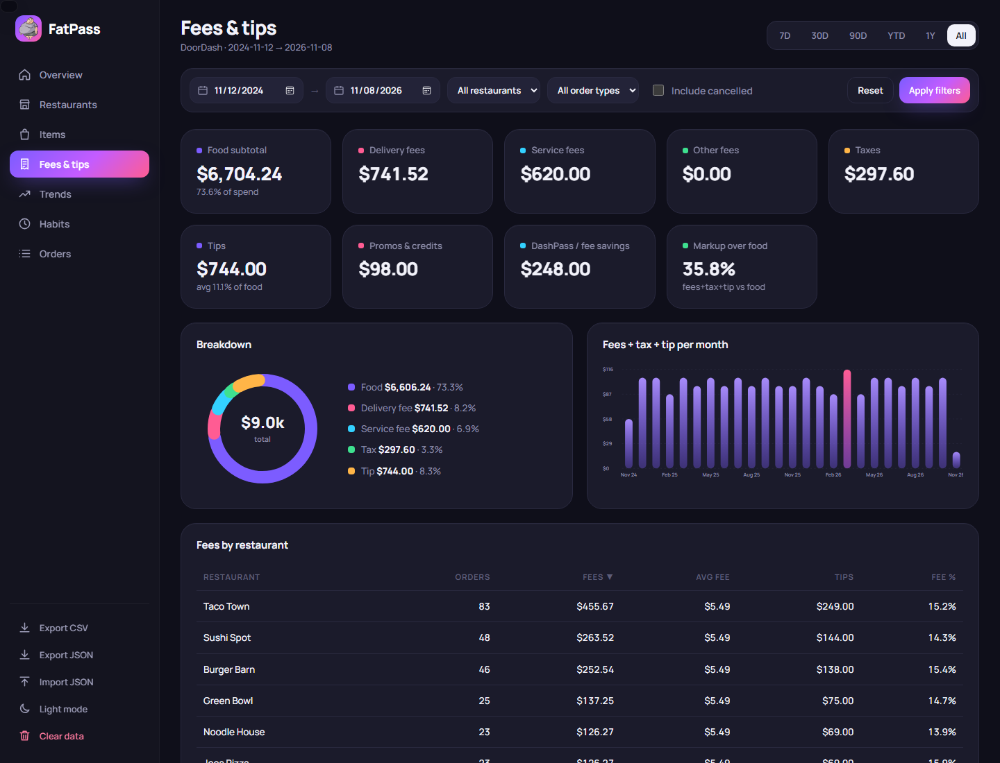
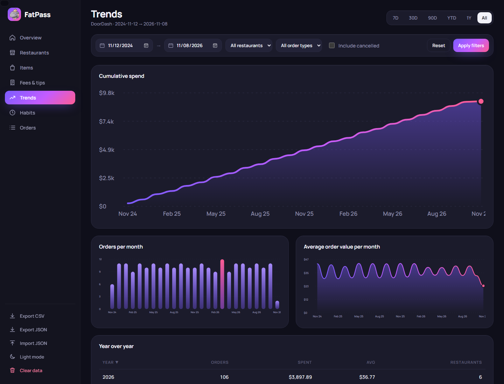
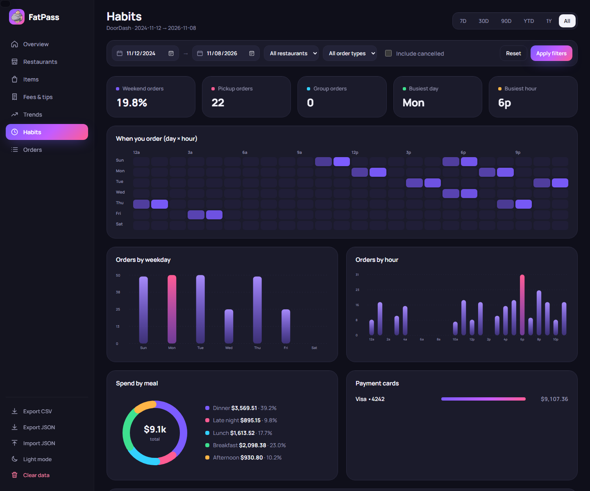
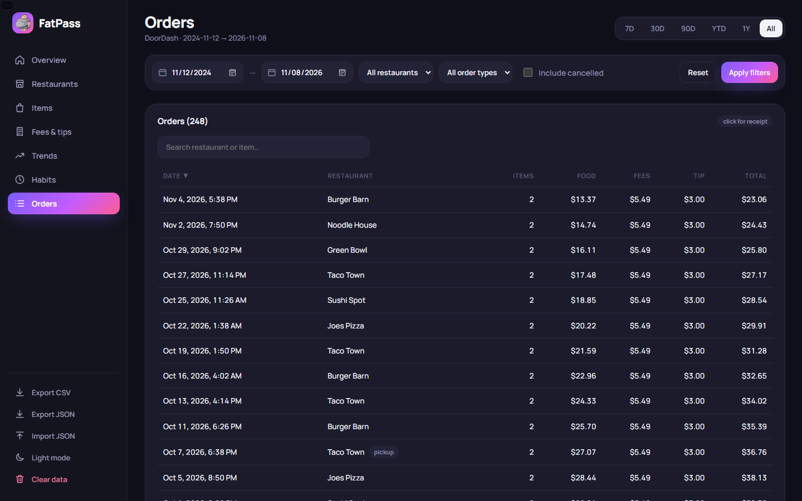
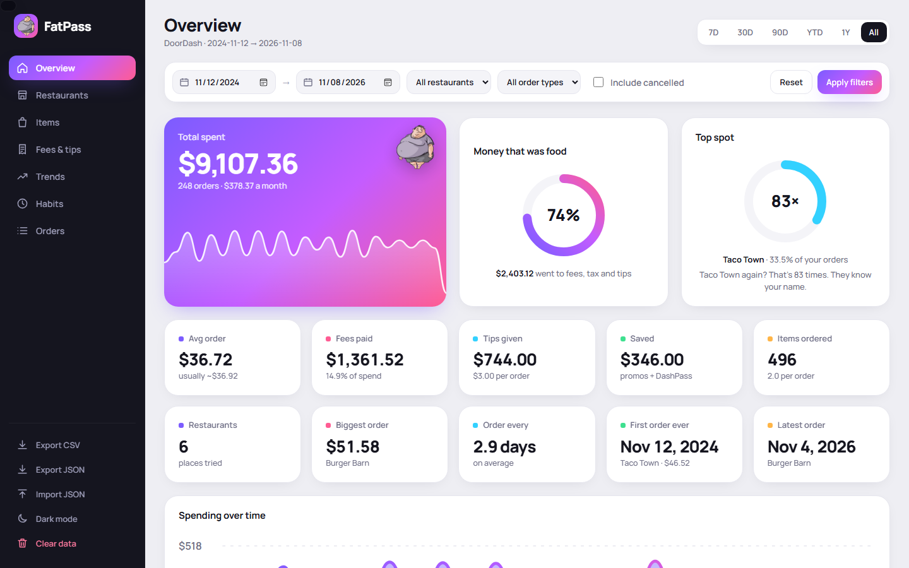

<p align="center">
  
</p>

<h1 align="center">FatPass</h1>

<p align="center">
  <b>See exactly how much you've spent on DoorDash: every order, fee and tip.</b><br>
  A free, private extension for Microsoft Edge and Google Chrome. No account, no servers, no tracking.
</p>

<p align="center">
  
  
  
  
  
</p>

<p align="center">
  
</p>

> Screenshots use made-up demo orders. Your dashboard shows your own DoorDash history.

---

## Contents

- [Features](#features)
- [Screenshots](#screenshots)
- [Install](#install)
- [How to use](#how-to-use)
- [How it works](#how-it-works)
- [Privacy](#privacy)
- [FAQ & troubleshooting](#faq--troubleshooting)
- [Project structure](#project-structure)
- [Contributing](#contributing)
- [Credits](#credits)

---

## Features

**Your whole order history in one place**
- Syncs every DoorDash order you've placed, including the full receipt for each one
- Fast: reads 6 receipts at once, and later syncs only grab new orders
- Splits every receipt into food, delivery fee, service fee, other fees, tax, tip, promos and DashPass savings

**7 dashboard tabs**

| Tab | What you get |
| --- | --- |
| **Overview** | Total spent, how much of it was actually food, your top restaurant, 10 quick stats, spending over time, where your money goes |
| **Restaurants** | Where you order most, highest average order, a sortable table of every place (click a row to filter to it) |
| **Items** | Your most ordered items, what you spent on each, and a search box |
| **Fees & tips** | Delivery, service and other fees, taxes, tips, promos, average tip %, and fees by restaurant |
| **Trends** | Running total, orders per month, average order per month, year-over-year table |
| **Habits** | A day × hour chart of when you order, busiest day and hour, meal times, payment cards, delivery addresses |
| **Orders** | Every order with search and sorting. Click one to see its full receipt and a link to it on DoorDash |

**Filters that apply to every tab**
- Quick ranges: 7D, 30D, 90D, YTD, 1Y, All (All starts at your first order)
- Custom from/to dates, restaurant, delivery/pickup/group, and an Include cancelled checkbox
- **Apply filters** and **Reset** buttons

**Extras**
- Hover any bar, line, ring or list row for exact numbers
- Export to CSV (opens in Excel or Google Sheets) or JSON, and import JSON back in
- Dark and light mode
- Works on small screens too

---

## Screenshots

<table>
  <tr>
    <td><p align="center"><b>Restaurants</b></p></td>
    <td><p align="center"><b>Fees &amp; tips</b></p></td>
  </tr>
  <tr>
    <td><p align="center"><b>Trends</b></p></td>
    <td><p align="center"><b>Habits</b></p></td>
  </tr>
  <tr>
    <td><p align="center"><b>Orders</b></p></td>
    <td><p align="center"><b>Light mode</b></p></td>
  </tr>
</table>

---

## Install

FatPass isn't on the Edge Add-ons or Chrome Web Store yet, so you load it yourself. It takes about a minute, and the steps are the same in both browsers.

1. **Download it.** Click the green **Code** button at the top of this page, then **Download ZIP**, and unzip it somewhere you'll keep it (for example your Documents folder).
2. **Open the extensions page.** Go to `edge://extensions` in Edge or `chrome://extensions` in Chrome.
3. **Turn on Developer mode.** In Edge it's the switch in the bottom-left corner; in Chrome it's in the top-right corner.
4. **Load it.** Click **Load unpacked** and pick the unzipped folder (the one with `manifest.json` inside).
5. **Pin it.** Click the puzzle-piece icon in the toolbar and pin FatPass so the mascot is always visible.

**Updating:** download the new ZIP, replace the old folder's files, then click **Reload** on FatPass on the extensions page. Your synced orders stay saved.

---

## How to use

1. Go to [doordash.com](https://www.doordash.com/orders/) and log in.
2. Click the FatPass icon in the toolbar.
3. Click **Sync new orders**. The progress bar shows how far along it is. Big histories (1,000+ orders) take a few minutes the first time.
4. Click **Open dashboard**.

Next time, just click **Sync new orders** again. It only grabs orders you've placed since the last sync, so it's quick.

| Popup button | What it does |
| --- | --- |
| **Sync new orders** | Adds orders placed since your last sync |
| **Full re-sync** | Throws out saved data and downloads your whole history again (use this if numbers look off) |
| **Open dashboard** | Opens the dashboard in a new tab |

---

## How it works

```
 doordash.com tab                     FatPass
 ┌──────────────────┐   your login   ┌────────────────────┐
 │ content.js       │ ─────────────▶ │ DoorDash's own     │
 │ (runs on the page)│ ◀───────────── │ order + receipt API│
 └────────┬─────────┘    orders      └────────────────────┘
          │ saves
          ▼
 ┌──────────────────┐   reads        ┌────────────────────┐
 │ browser storage  │ ─────────────▶ │ dashboard.html     │
 │ (only on your PC)│                │ (charts + tables)  │
 └──────────────────┘                └────────────────────┘
```

- When you click **Sync**, `content.js` asks DoorDash for your order list, 25 at a time, the same way the DoorDash Orders page does. It uses your existing login, so FatPass never sees or stores your password.
- For each order it also fetches the receipt, 6 at a time, and sorts each receipt line (Subtotal, Delivery Fee, Service Fee, Tax, Dasher Tip, promos…) into categories.
- Everything gets saved in your browser's extension storage. The dashboard reads it from there and draws every chart itself, with no chart libraries and no outside requests (apart from loading the font).
- If you log into a different DoorDash account, FatPass clears the old account's orders first so they don't get mixed together.

---

## Privacy

- **Your data stays on your computer.** Orders are kept in your browser's local extension storage and never get uploaded anywhere.
- **No analytics, no tracking, no ads, no account.**
- **Only talks to doordash.com**, and only when you click Sync.
- **Permissions it asks for:**
  - `storage` / `unlimitedStorage`: to save your orders locally (big histories go over the default limit)
  - `tabs` / `scripting`: to check you're on DoorDash and start the sync in that tab
  - `https://www.doordash.com/*`: to read your orders
- **Delete everything** anytime with **Clear data** in the dashboard, or by removing the extension.

---

## FAQ & troubleshooting

<details>
<summary><b>The popup says "Open DoorDash while logged in to sync."</b></summary>

The sync runs inside a DoorDash tab. Open [doordash.com/orders](https://www.doordash.com/orders/), make sure you're logged in, then click the FatPass icon again.
</details>

<details>
<summary><b>It says "Reload the DoorDash tab, then try again."</b></summary>

This happens if you installed or reloaded FatPass while DoorDash was already open. Refresh the DoorDash tab and try again.
</details>

<details>
<summary><b>My numbers look wrong, or old orders show up that aren't mine.</b></summary>

Click **Full re-sync** in the popup. That wipes the saved data and downloads your history fresh. If someone else ever synced their account in your browser, this clears theirs out.
</details>

<details>
<summary><b>Some orders say they have no receipt details.</b></summary>

DoorDash sometimes fails to return a receipt. Totals are still right, but the fee breakdown is missing for those orders. Run **Full re-sync** to try again.
</details>

<details>
<summary><b>Does it count cancelled orders?</b></summary>

No, not unless you check **Include cancelled** in the filters.
</details>

<details>
<summary><b>Does it work with Uber Eats or Grubhub?</b></summary>

Not right now. FatPass is DoorDash only.
</details>

<details>
<summary><b>The sync stopped working.</b></summary>

DoorDash sometimes changes its website. Please [open an issue](../../issues) with the error message from the popup.
</details>

---

## Project structure

```
FatPass/
├── manifest.json     extension settings (Manifest V3)
├── content.js        runs on doordash.com, fetches orders + receipts
├── popup.html/.js    toolbar popup: sync buttons and progress
├── dashboard.html    the dashboard page
├── dashboard.css     all dashboard styles (dark + light)
├── dashboard.js      filters, tabs, charts, tables, export/import
├── icons/            toolbar icons + mascot
└── screenshots/      images for this README
```

Plain HTML, CSS and JavaScript. Nothing to install, no build step. Edit a file, click **Reload** on the extensions page, and refresh the dashboard.

---

## Contributing

Bug reports and pull requests are welcome.

1. Fork the repo and make your change.
2. Load your copy with **Load unpacked** and test it on your own DoorDash account.
3. Open a pull request saying what you changed and why.

Ideas: Uber Eats and Grubhub support, monthly budget alerts, charts you can share, and publishing to the Edge Add-ons and Chrome Web Store.

---

## Credits

- Inspired by [BiteStats](https://github.com/SDev6699/bitestats) by Sahil Atul Darandale (MIT License).
- Font: [Manrope](https://fonts.google.com/specimen/Manrope) from Google Fonts.

**Disclaimer:** FatPass is an independent project and isn't affiliated with, endorsed by or sponsored by DoorDash. "DoorDash" and "DashPass" are trademarks of DoorDash, Inc. This extension is also made with claude.

## License

[MIT](LICENSE)
